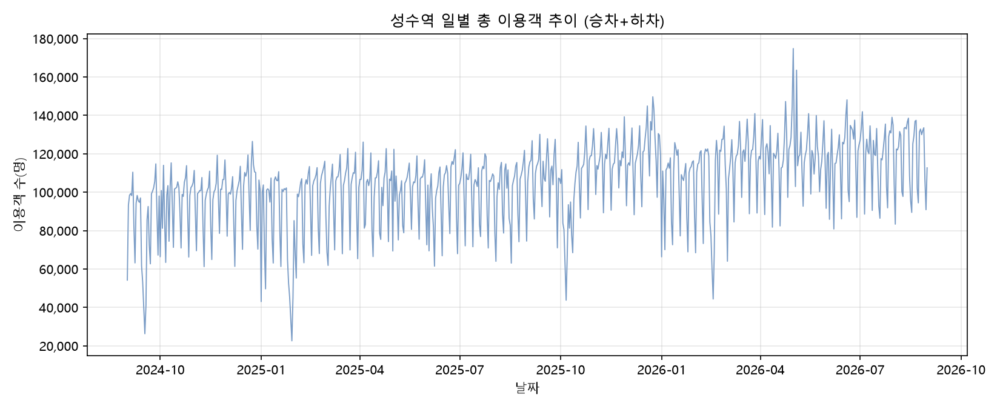
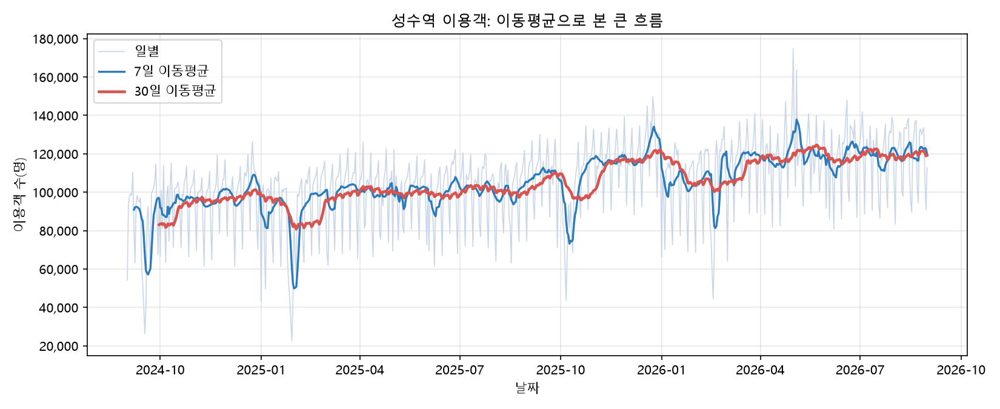
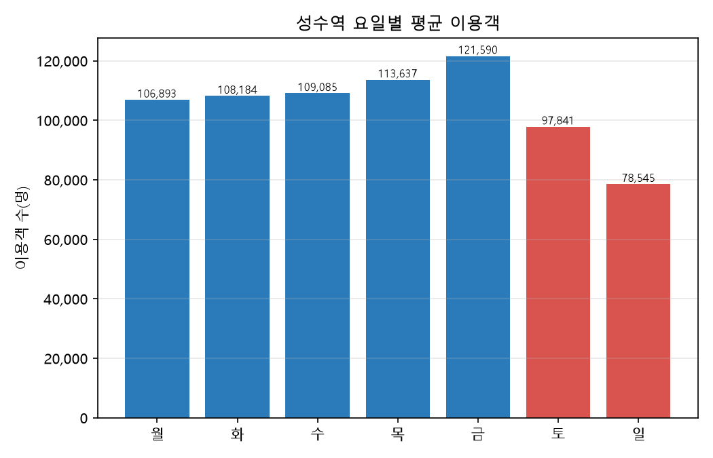
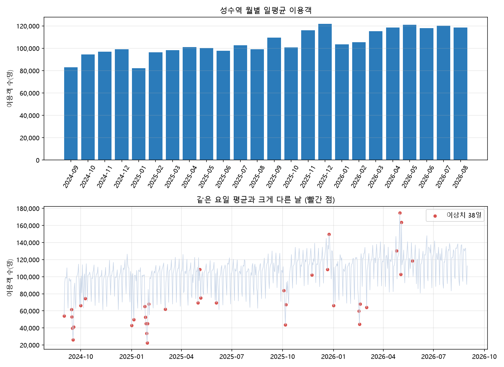

# 성수역 일별 이용객 추세 분석 리포트

## 1. 분석 주제와 선정 이유

서울 지하철 2호선 성수역의 일별 승차 인원과 하차 인원을 합산해 이용객 추세를 살펴본다. 그래프의 모양만 나열하지 않고, 기간에 따른 변화와 요일별 차이, 평소와 다른 날을 수치로 확인해 해석한다.

이 주제를 고른 이유는, 성수 일대의 인기가 예전보다 높아져서 사람들이 더 많이 찾게 된 것은 아닐까 하는 사소한 생각이 들었기 때문이다. 이 생각이 실제 이용객 수에 나타나는지 데이터로 확인해 보고 싶었다. 다만 이 자료만으로는 이용객이 늘어난 원인까지 확인할 수 없으므로, 인기와의 관련성은 확인된 사실이 아니라 가설로만 다룬다.

## 2. 분석 질문

1. 분석 기간 동안 성수역 이용객은 전반적으로 늘었는가, 줄었는가?
2. 평일과 주말, 요일별 이용객은 얼마나 다른가?
3. 같은 요일의 평소 수준보다 이용객이 크게 늘거나 줄어든 날은 언제인가?

## 3. 데이터 설명

- 출처: 서울 열린데이터광장, 「서울시 지하철호선별 역별 승하차 인원 정보」의 월별 CSV (`CARD_SUBWAY_MONTH_YYYYMM.csv`)
- 분석 대상: 노선명 `2호선`, 역명 `성수`
- 기간: 2024-09-01 ~ 2026-08-31
- 데이터 수: 730개 일별 관측값
- 값의 의미: 티머니 제공 집계이며 환승객 여부와 상관없이 집계된다. `total`은 승차와 하차의 합이다.
- 라이선스: 공공누리 1유형(출처표시, 상업적 이용 및 변경 가능). 저작권자는 서울특별시, 코레일, 공항철도이며 제3저작권자는 없다. 서울 열린데이터광장 데이터셋 페이지의 이용허락범위를 2026-10-25에 확인했다.
- 출처 표시: 서울특별시, 「서울시 지하철호선별 역별 승하차 인원 정보」, 서울 열린데이터광장 (https://data.seoul.go.kr/dataList/OA-12914/S/1/datasetView.do)
- 변경 사항: 원본 월별 CSV에서 2호선 성수역의 일별 승차·하차 값만 추출하고, 승차와 하차를 합산한 total 열을 추가했다.

## 4. 데이터 정제

월별 원본 CSV에서 날짜, 노선명, 역명, 승차, 하차 열을 읽고 성수역 2호선 자료만 골랐다. CSV 줄 끝 쉼표로 열이 어긋나는 문제를 피하기 위해 `index_col=False`, `dtype=str`를 사용하고, `utf-8-sig`, `cp949`, `euc-kr` 인코딩을 순서대로 시도한다. 숫자 열의 쉼표를 제거해 숫자로 변환한 뒤 날짜별 승차·하차를 합산했다.

- 결측값: 0개
- 빠진 날짜: 0일
- 중복 날짜 처리: 같은 날짜가 여러 행으로 나오면 합산하도록 처리했다.
- 처리 기준: 현재 분석 데이터에서 결측값이나 빠진 날짜가 확인되지 않아 별도 보정하지 않았다. 이상치는 실제 관측값일 수 있으므로 삭제하지 않고 표시했다.
- 확인 방법: Python에서 `data/seongsu_daily.csv`를 읽어 `isna().sum().sum()`으로 결측 셀을 세고, 첫 날짜부터 마지막 날짜까지 `date_range`를 만든 뒤 데이터 날짜와의 차집합으로 빠진 날짜를 셌다.

### 적용한 시계열 기법과 선택 이유

- **이동평균(7일, 30일):** 요일에 따라 값이 크게 달라서 7일로 요일 효과를 줄이고, 30일로 큰 흐름을 봤다.
- **전월 대비 변화율:** 월마다 절대 숫자가 달라 변화 폭을 같은 기준(%)으로 비교하려고 썼다.
- **요일별 집계:** 평일과 주말 수요 차이를 확인하려고 썼다.
- **변동성(표준편차):** 하루 값이 평균 대비 얼마나 흔들리는지 보려고 썼다.
- **집계 단위:** 기본은 일 단위로 분석했다. 요일 패턴은 일 단위에서만 보이고, 월 단위는 큰 흐름과 계절 영향을 보려고 보조로 썼다.
- **이상치 기준(±30%):** 요일마다 평소 수준이 달라 같은 요일 평균과 비교했고, 30%는 분석을 위해 임의로 정했다. 기준을 바꾸면 이상치 개수가 달라진다.

## 5. 분석 결과 및 시각화

### 5-1. 일별 추세

**그래프에서 읽을 수 있는 것:** 일별 이용객은 날짜마다 크게 오르내린다. 전체 기간의 일평균은 105,077명이고, 최소 22,585명(2025-01-29)부터 최대 174,796명(2026-05-01)까지 관찰됐다.

### 5-2. 이동평균

**그래프에서 읽을 수 있는 것:** 7일 이동평균은 짧은 기간의 변화를, 30일 이동평균은 더 완만한 흐름을 보여준다. 앞쪽 절반의 일평균 96,005명과 뒤쪽 절반의 114,148명을 비교하면 뒤쪽이 18.9% 높다.

### 5-3. 요일별 평균

**그래프에서 읽을 수 있는 것:** 금요일 평균은 121,590명으로 요일 중 가장 높고, 일요일은 78,545명으로 가장 낮다. 평일 평균 111,868명에 비해 주말 평균은 88,147명으로 평일의 79%다.

### 5-4. 월별 평균 및 이상치

**그래프에서 읽을 수 있는 것:** 월별 일평균은 2025-10의 100,917명에서 2025-11의 116,026명으로 상승했다. 2025-11 이전에는 월별 일평균의 최대가 109,580명(2025-09)이었고, 2025-11 이후에는 1~2월(2026-01 103,501명, 2026-02 105,574명)을 제외한 모든 달이 115,000명 이상이다. 같은 요일 평균보다 30% 이상 높거나 낮은 날은 모두 38일로 표시됐다.

### 대시보드

Streamlit 대시보드에서는 기간, 지표(총 이용객·승차·하차), 이동평균 일수, 요일, 이상치 기준을 바꿔 결과를 살펴볼 수 있다. 배포 전에는 프로젝트 폴더에서 `streamlit run app.py`를 실행한다.

- 배포 URL: **TODO: 배포 후 URL 입력**
- 스크린샷: **TODO: 여기에 대시보드 화면 캡처를 추가**
- 캡처 시나리오: [docs/dashboard_scenarios.md](docs/dashboard_scenarios.md)

## 6. 인사이트

### 인사이트 1. 분석 후반부의 일평균이 더 높다

- **관찰(근거):** 앞쪽 절반의 일평균은 96,005명, 뒤쪽 절반은 114,148명으로 뒤쪽이 18.9% 높다. 처음 90일 평균 91,469명과 마지막 90일 평균 118,938명을 비교하면 30.0% 높다.
- **원인 가설:** 성수 일대의 방문 수요나 상권 변화가 이용객 증가에 반영됐을 수 있다. 다만 이 데이터는 승하차 합계라 방문 목적을 구분할 수 없고, 외부 요인은 확인하지 않았다. **TODO: 확인 필요**
- **행동(Action):** 더 긴 기간의 자료와 주변 역 또는 외부 요인 자료를 함께 비교해 증가 흐름이 지속되는지 확인한다.

### 인사이트 2. 금요일이 가장 붐비고 주말 평균은 평일보다 낮다

- **관찰(근거):** 금요일 평균은 121,590명으로 가장 높고 일요일 평균은 78,545명으로 가장 낮다. 주말 평균 88,147명은 평일 평균 111,868명의 79%다.
- **원인 가설:** 요일별 통근·방문 수요 차이가 반영됐을 수 있다. 방문 목적이나 승객 구성은 이 자료에서 구분할 수 없다.
- **행동(Action):** 대시보드에서 요일을 선택해 기간별 요일 패턴을 비교한다.

### 인사이트 3. 같은 요일 기준으로 크게 낮거나 높은 날이 나타난다

- **관찰(근거):** 같은 요일 평균보다 30% 이상 다른 날은 38일이다. 크게 낮은 날에는 2024-09-16~18과 2025-01-27~30이 포함되고, 크게 높은 날에는 2026-05-01, 2026-05-03~04가 포함된다.
- **원인 가설:** 낮은 날짜는 명절 기간의 영향일 수 있고, 높은 날짜는 휴일·행사 등과 관련됐을 수 있다. 해당 날짜의 실제 원인은 자료에서 확인되지 않아 **TODO: 확인 필요**다.
- **행동(Action):** 날짜별 공휴일·행사·날씨 자료를 찾아 대조하고, 확인한 출처를 추가한다.

### 인사이트 4. 1월에 전월 대비 감소가 두 번 관찰됐다

- **관찰(근거):** 월별 일평균의 전월 대비 변화는 2025-01에 -17.2%, 2026-01에 -15.0%였다.
- **원인 가설:** 연초에 반복되는 요인이 있을 수 있지만, 2년 자료만으로 계절성이 확정되지는 않는다. 원인은 **TODO: 확인 필요**다.
- **행동(Action):** 더 많은 연도의 자료를 모아 1월 감소가 반복되는지 확인한다.

## 7. 결론 및 한계점

분석 기간 후반부의 일평균은 앞쪽 절반보다 높았고, 요일별로도 이용객 차이가 확인됐다. 같은 요일 평균에서 크게 벗어난 날짜를 별도로 표시해 추가 조사할 대상을 찾았다.

- 환승객 여부와 관계없이 집계된 값이므로 이용객 수를 성수역 방문객 수와 같다고 볼 수 없다.
- 승차와 하차의 합계라 통근객과 방문객을 구분할 수 없다.
- 분석 기간이 2년이므로 계절성을 확정하기 어렵다.
- 날씨, 행사, 정책 등 외부 변수는 분석하지 않았다. 원인과 연결하려면 **TODO: 확인 필요**다.
- 이상치 기준인 같은 요일 평균 대비 ±30%는 분석을 위해 정한 기준이다.
- 데이터 이용 조건은 3장에 기재했다(공공누리 1유형, 출처표시).

## 8. AI 사용 로그

| 사용 작업 | 사용 이유 | 검증 방법 |
|---|---|---|
| Claude: 주제 선정, 코드 초안, 해석 정리 | 주제 후보를 정리하고 분석 코드와 해석 초안을 빠르게 준비 | 데이터 처리·분석 코드를 실행해 생성된 `data/summary.txt` 숫자와 대조하고, 근거가 없는 원인 설명은 가설로 표시 |
| Codex: 코드 정리, 대시보드 구현 | 코드 구조를 정리하고 결과를 조건별로 살펴볼 대시보드를 준비 | 대시보드 기본값의 평균과 이상치 수를 `data/summary.txt`와 대조하고, 요일을 선택하지 않은 경우 안내 문구가 나오는지 확인 |

※ 결과 해석은 그래프와 요약 수치에 근거해 확인하며, 원인 가설은 외부 자료로 확인되기 전까지 사실로 단정하지 않는다.
